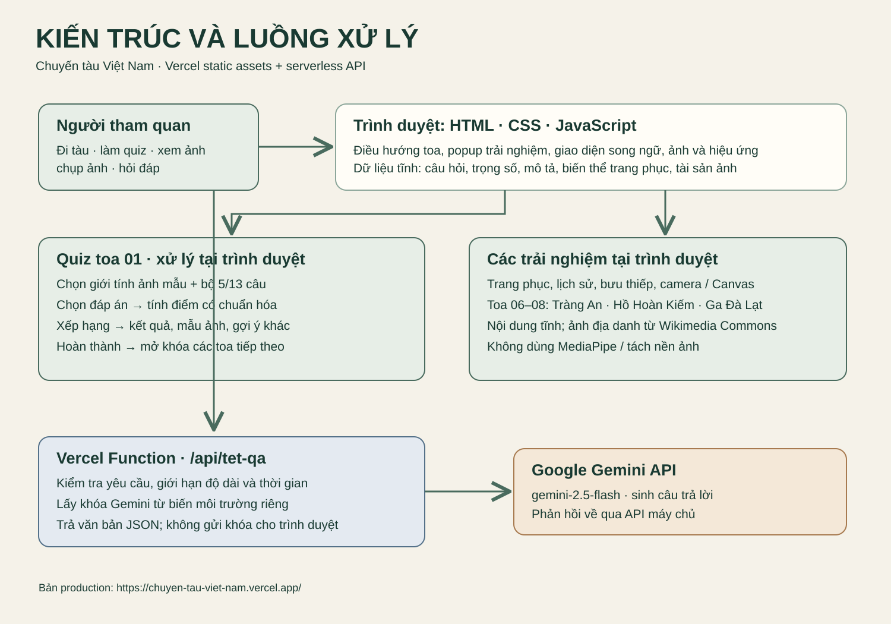
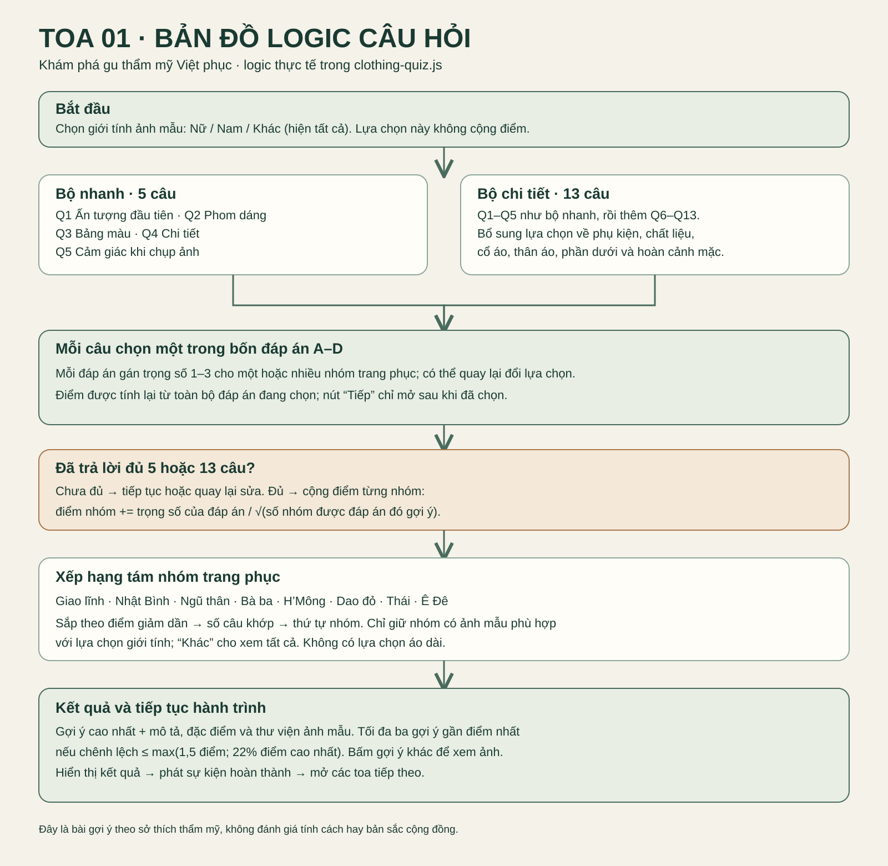

# Mô tả kiến trúc hệ thống “Chuyến tàu Việt Nam”

Ứng dụng là một website trải nghiệm tương tác. Người tham quan điều hướng giữa các toa tàu, xem nội dung văn hóa và hình ảnh, làm bài khám phá trang phục ở toa 01, rồi mở các toa còn lại. Phần lớn giao diện và tương tác chạy ngay trong trình duyệt; phần hỏi đáp AI gửi yêu cầu tới API phía máy chủ để giữ khóa Gemini ngoài mã công khai.

## Kiến trúc và công nghệ

- **Giao diện:** HTML, CSS và JavaScript thuần trong `train-journey/dist/`. Các tệp `app.js`, `carriages-*.js`, `interiors.js` và các mô-đun trải nghiệm dựng toa tàu, điều hướng và popup. `destinations.js` hiển thị ba điểm khám phá có ảnh ở các toa 06–08: Tràng An (Ninh Bình), hồ Hoàn Kiếm (Hà Nội) và ga Đà Lạt (Lâm Đồng). CSS xử lý bố cục responsive; `i18n.js` cùng các tệp `translations-*.js` cung cấp tiếng Việt và tiếng Anh.
- **Bài khám phá toa 01:** `clothing-quiz-data.js` khai báo tám nhóm trang phục, 13 câu hỏi và trọng số đáp án. `clothing-quiz.js` điều khiển UI, chấm điểm và mở khóa hành trình. `clothing-facts.js` bổ sung mô tả và liên kết tìm hiểu; ảnh mẫu nằm trong `dist/garments/`.
- **Ảnh và camera:** `photobooth.js` nhận ảnh tải lên hoặc truy cập camera bằng `getUserMedia` khi được người dùng cho phép. Canvas dùng để chuẩn hóa, ghép khung và xuất ảnh tải xuống. Phiên bản hiện tại không dùng MediaPipe hoặc tách nền ảnh. Luồng tạo ảnh thử trang phục, nếu được cấu hình, gọi một API riêng qua `photobooth-config.js`.
- **Hỏi đáp AI:** `tet-qa.js` gọi cùng nguồn `/api/tet-qa`. Hàm Vercel tại `train-journey-vercel/api/tet-qa.js` kiểm tra phương thức và kích thước yêu cầu; `train-journey-vercel/gemini-qa.cjs` kiểm tra lịch sử hội thoại, giới hạn độ dài và thời gian chờ rồi gọi Google Gemini `gemini-2.5-flash`. Khóa API đọc từ biến môi trường `GEMINI_API_KEY`; phản hồi trả về dưới dạng JSON. `train-journey/preview.cjs` vẫn là endpoint xem trước cục bộ.
- **Triển khai:** `train-journey-vercel/` là dự án Vercel. Tài sản giao diện tĩnh được đưa vào `public/`; `api/tet-qa.js` chạy như Vercel Function cùng tên miền. `GEMINI_API_KEY` được cấu hình trong Environment Variables của dự án Vercel, không đặt trong `public/` hoặc commit vào mã nguồn. Bản production đã được triển khai tại https://chuyen-tau-viet-nam.vercel.app/.

## Dữ liệu

Dữ liệu chính là các tệp tĩnh: nội dung toa tàu, bản dịch, bộ câu hỏi và trọng số, mô tả trang phục, ảnh mẫu, ba ảnh địa danh cùng ghi chú nguồn và các hình minh họa. Lựa chọn câu hỏi, trạng thái popup và vị trí toa hiện tại nằm trong bộ nhớ của phiên trang; sự kiện `train-quiz-completed` mở khóa các toa khi người dùng xem kết quả. `localStorage` chỉ lưu một số tùy chọn giao diện như ngôn ngữ, chủ đề và âm thanh. Ảnh người dùng cung cấp được xử lý trong phiên trình duyệt; chỉ gửi tới API ảnh khi họ chủ động dùng tính năng tạo ảnh có cấu hình. Lịch sử hỏi đáp ngắn được gửi tới `/api/tet-qa` khi người dùng đặt câu hỏi.

## Luồng xử lý chính

1. Trình duyệt tải trang và các tài sản tĩnh. JavaScript dựng toa tàu và khôi phục tùy chọn giao diện đã lưu.
2. Ở toa 01, người dùng chọn giới tính để lọc **ảnh mẫu**, sau đó chọn bộ nhanh 5 câu hoặc bộ chi tiết 13 câu. Giới tính không cộng điểm. Mỗi câu có bốn đáp án và chỉ cho đi tiếp sau khi chọn.
3. Bài quiz tính lại tổng điểm từ các lựa chọn hiện tại. Mỗi trọng số được chia cho căn bậc hai của số nhóm được đáp án đó gợi ý, giúp đáp án trải rộng nhiều nhóm không lấn át đáp án đặc trưng. Các nhóm được xếp theo điểm, số câu khớp và thứ tự khai báo; chỉ nhóm có ảnh mẫu phù hợp mới vào kết quả. Gợi ý gần điểm nhất được hiển thị để người dùng xem thêm.
4. Khi kết quả hiện ra, ứng dụng phát sự kiện hoàn thành và mở các toa tiếp theo. Ở toa 06–08, người dùng xem ảnh và nội dung ngắn về Tràng An, hồ Hoàn Kiếm và ga Đà Lạt. Các trải nghiệm khác được điều khiển bởi mô-đun JavaScript tại trình duyệt.
5. Với hỏi đáp AI, trình duyệt gửi câu hỏi và tối đa tám lượt hội thoại gần nhất tới `/api/tet-qa`. API kiểm tra dữ liệu, thêm hướng dẫn chủ đề văn hóa, gọi Gemini bằng khóa bí mật và trả câu trả lời. Khi API không khả dụng, giao diện có thể dùng nội dung trả lời cục bộ tùy trạng thái cấu hình.

## Giải pháp kỹ thuật chính

Việc tách nội dung tĩnh khỏi API giúp website tải nhanh và giảm phụ thuộc vào máy chủ cho các tương tác thông thường. Chấm điểm quiz tại trình duyệt tạo phản hồi tức thời và cho phép quay lại đổi đáp án mà không cộng điểm trùng. Lọc ảnh mẫu độc lập với điểm số giúp gợi ý bám theo sở thích mà vẫn hiển thị mẫu phù hợp. Các popup khóa tương tác nền, hỗ trợ bàn phím và hoàn trả tiêu điểm khi đóng. API AI dùng kiểm tra đầu vào, giới hạn số lượt, độ dài và thời gian chờ; khóa chỉ tồn tại ở máy chủ. Nội dung về trang phục được diễn đạt như gợi ý thẩm mỹ, không suy luận tính cách hay đại diện toàn bộ cộng đồng từ một mẫu ảnh.

